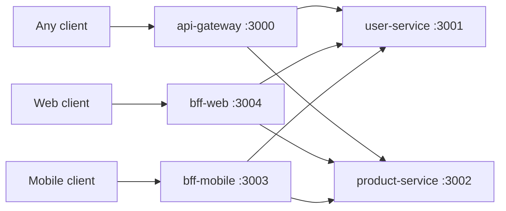

# NestJS API Gateway vs BFF

A side-by-side demo of two edge patterns in front of the same microservices, built with NestJS.
A single **API Gateway** forwards client calls unchanged, while two **Backends for Frontends** (web and mobile)
call the same services and shape the response for their own client.

## What this demonstrates

- **API Gateway**: one entry point that proxies `/users` and `/products` to the downstream services and returns
  their payload as-is
- **Web BFF**: wraps the full service response in `{ data }` for a web client
- **Mobile BFF**: trims each record to `id` and `name` (drops fields like `price`) to keep mobile payloads small
- Two minimal downstream services (users, products) returning in-memory data
- Each app is an independent NestJS project with its own `package.json`

## Tech stack

- NestJS 10, TypeScript
- axios for service-to-service HTTP calls (gateway and BFFs)
- Jest for the generated unit/e2e test scaffolding

## Architecture



Downstream URLs are hardcoded as `http://localhost:3001` and `http://localhost:3002` in the gateway and BFF controllers.

## Getting started

Prerequisites: Node.js and npm.

Install and start each app in its own terminal (start the two services first):

```bash
cd user-service && npm install && npm run start:dev      # :3001
cd product-service && npm install && npm run start:dev   # :3002
cd api-gateway && npm install && npm run start:dev       # :3000
cd bff-mobile && npm install && npm run start:dev        # :3003
cd bff-web && npm install && npm run start:dev           # :3004
```

Then compare the responses:

```bash
curl localhost:3000/products         # gateway: raw list
curl localhost:3004/web/products     # web BFF: { data: [...] } with all fields
curl localhost:3003/mobile/products  # mobile BFF: { data: [...] } with id and name only
```

Other scripts in every app: `npm run build`, `npm run start:prod`, `npm test`, `npm run test:e2e`, `npm run lint`.

## Environment variables

| Name | Meaning |
|------|---------|
| `PORT` | Port the app listens on (defaults: gateway 3000, users 3001, products 3002, mobile BFF 3003, web BFF 3004) |

## API endpoints

| App | Method | Path | Purpose |
|-----|--------|------|---------|
| user-service | GET | `/users` | List users (`id`, `name`) |
| product-service | GET | `/products` | List products (`id`, `name`, `price`) |
| api-gateway | GET | `/users` | Proxy to user-service, unchanged |
| api-gateway | GET | `/products` | Proxy to product-service, unchanged |
| bff-web | GET | `/web/users` | Users wrapped in `{ data }` |
| bff-web | GET | `/web/products` | Products wrapped in `{ data }` |
| bff-mobile | GET | `/mobile/users` | Users as `{ data }` with `id`, `name` |
| bff-mobile | GET | `/mobile/products` | Products as `{ data }` with `id`, `name` only |

## Project structure

```
.
├── api-gateway/       # generic gateway (src/app.controller.ts)
├── bff-web/           # web BFF (src/web-bff.controller.ts)
├── bff-mobile/        # mobile BFF (src/mobile-bff.controller.ts)
├── user-service/      # users (src/user.controller.ts)
└── product-service/   # products (src/product.controller.ts)
```
